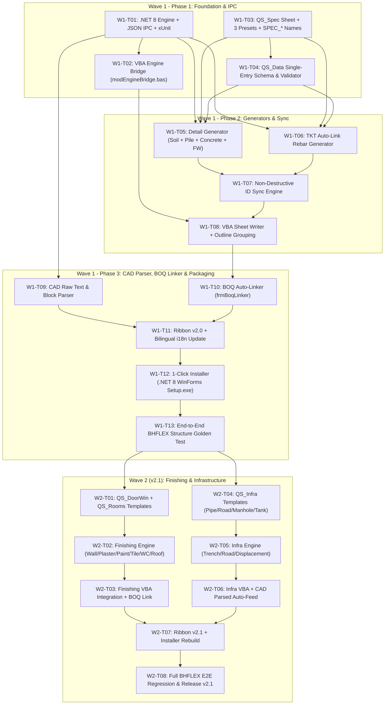

# Implementation Plan: zOfit QS Pro — Wave 1 (v2.0) & Wave 2 (v2.1)

> **Tài liệu đặc tả gốc**: [docs/spec.md](../docs/spec.md)
> **Bảng theo dõi Task chi tiết**: [tasks/todo.md](todo.md)
> **Bộ nhớ dự án**: [memory.md](../memory.md)

---

## 1. Overview (Tổng quan kế hoạch)

Kế hoạch triển khai **zOfit QS Pro** từ nền tảng v1.0 hiện có (`dist/zOfit_QS_Pro.xlam`) lên hệ thống **QS Bán Tự Động Kiến trúc Lai** qua **2 Đợt (Waves)** nối tiếp:

- **Wave 1 (v2.0 — Core Hybrid Engine, Structure/Earthwork/Rebar Single-Entry, CAD Parser, BOQ Linker & 1-Click `.exe` Installer)**: Giải quyết triệt để 4 điểm nghẽn thực tế phát hiện trong file dự thầu BHFLEX (nhập trùng `RC` vs `*_Detail`, lỗi `#REF!`, tách text CAD thô, cài đặt khó cho người dùng cuối). Sau Wave 1 có thể áp dụng ngay vào dự án thực tế.
- **Wave 2 (v2.1 — Finishing & Infrastructure Modules + Full End-to-End BHFLEX Benchmark)**: Mở rộng sang Hoàn thiện (`QS_DoorWin`, `QS_Rooms`, dây chuyền Mái/WC) và Hạ tầng (`QS_Infra` đường nội bộ, tuyến cống/mương, hố ga, bể ngầm).

---

## 2. Architecture Decisions (Các quyết định kiến trúc chính)

1. **Tách lõi tính toán sang `.NET 8` (`zofit-engine.exe`)**:
   - Đóng gói `-r win-x64 --self-contained true -p:PublishSingleFile=true`, chạy độc lập không cần cài `.NET` hay `Python`.
   - Toàn bộ thuật toán phức tạp (CAD Regex Parser, sinh công thức `*_Detail`, sinh công thức `TKT_*`, Non-destructive ID Sync, tính toán Hoàn thiện/Hạ tầng) viết bằng C# thuần + kiểm thử tự động bằng **xUnit** trong vài giây.
2. **Giao tiếp VBA ↔ Engine qua JSON File IPC (`%TEMP%\zofit_ipc\`)**:
   - VBA đọc range từ workbook ra JSON → chạy `zofit-engine.exe --cmd <op> --in req.json --out res.json` (ẩn cửa sổ console) → ghi ngược kết quả vào Excel bằng **Bulk Variant Array (1-shot)** để đạt tốc độ `< 1 giây` cho hàng nghìn dòng.
   - Không phụ thuộc COM registration hay quyền Admin doanh nghiệp.
3. **100% Công thức Excel chuẩn (2007–365)**:
   - Engine KHÔNG trả về số chết cho các ô tính toán; Engine sinh **chuỗi công thức Excel tường minh** (`=QS_Data!G12*1000-2*MAX(SPEC_Cover_Ftg,O5)`, `=PRODUCT(E34:K34)`, `=SUBTOTAL(9,L33:L46)`).
   - Thay đổi kích thước trên `QS_Data` hoặc thông số trên `QS_Spec` → toàn bộ workbook nhảy số tức thì mà không cần mở Add-in.
4. **Đóng gói 1-Click Installer (`zOfit_QS_Pro_Setup.exe`)**:
   - Viết bằng `.NET 8 WinForms` single-file, nhúng sẵn `zOfit_QS_Pro.xlam` và `zofit-engine.exe` làm Embedded Resources.
   - Tự kiểm tra `EXCEL.EXE`, giải nén vào `%APPDATA%\Microsoft\AddIns\` & `%LOCALAPPDATA%\zOfitQSPro\`, gỡ `Zone.Identifier`, ghi khóa `OPEN` trong `HKCU\Software\Microsoft\Office\16.0\Excel\Options`, hỗ trợ Upgrade & Uninstall.

---

## 3. Dependency Graph (Đồ thị phụ thuộc)

---

## 4. Phase Breakdown & Verification Checkpoints

### WAVE 1 — v2.0 (Core Hybrid Engine + Structure/Earthwork/TKT + CAD Parser + BOQ Linker + 1-Click Installer)

#### Phase 1.1: Foundation & Single-Entry Schemas (`W1-T01` → `W1-T04`)
- Khởi tạo solution C# `.NET 8` (`zOfit.Engine` + `zOfit.Engine.Tests`) với hợp đồng JSON IPC chuẩn.
- Xây dựng `modEngineBridge.bas` (VBA gọi `zofit-engine.exe` ẩn, xử lý UTF-8 tiếng Việt sạch, timeout & thông báo lỗi rõ ràng).
- Tạo `QS_Spec` chuẩn hóa 100% từ 6 file spec của dự án (`SPEC_*` Named Ranges + 3 Presets).
- Tạo `QS_Data` (Single-Entry theo `Building/Zone`, ô kích thước mở tương thích `Linkcad`, Data Validation + tự sinh `ElementID`).
- **Checkpoint CP-1.1**: `dotnet test` Pass; từ Excel gọi được `zofit-engine.exe --cmd ping` trả về JSON tiếng Việt; tạo `QS_Spec` & `QS_Data` không lỗi.

#### Phase 1.2: Core Formula Generators & Non-Destructive Sync (`W1-T05` → `W1-T08`)
- `RcDetailGenerator`: Từ `QS_Data` + `QS_Spec` sinh trọn bộ `<Building>_Detail` (Cọc PHC, Đào/Lấp đất, Đầm nền, Cấp phối, Màng PE, BT lót, BT kết cấu, Cốp pha trừ giao) đúng format `NO|L|W|H|a|b|c|QTY` + `SUBTOTAL(9,...)`.
- `RebarBbsGenerator`: Từ cùng dòng `QS_Data` + `QS_Spec` sinh `TKT_<Building>` cho 8 template (`FTG_2WAY`, `BEAM_STD`, `COL_STD`, `SLAB_2WAY_2LAYER`, `WALL_2FACE`, `STAIR_6BAR`, `MANHOLE_STD`, `PILE_HEAD`) — tất cả chiều dài thanh, số thanh `@`, neo/nối, Coupler đều là **công thức Excel sống link về `QS_Data` & `SPEC_*`**.
- `SyncEngine`: Đồng bộ theo `ElementID`, bảo toàn 100% dòng `MANUAL` người dùng chèn tay, highlight `[REMOVED]` thay vì xóa ngầm.
- `modQsWriter.bas`: Ghi bulk 2D array vào Excel, áp dụng định dạng màu/font/Outline Grouping 3 cấp, tự động cập nhật `TH_Thep_ToanCT` chia theo `BOQ_Bucket`.
- **Checkpoint CP-1.2**: Nhập cụm `49.ELECTRIC SUPPLY` vào `QS_Data` → 1-click sinh `49.ELECTRIC SUPPLY_Detail` + `TKT_49.ELECTRIC SUPPLY` trong `< 3 giây`, **0 lỗi công thức**, đổi `L` của `PC1` mọi sheet nhảy số tức thì, test `Sync` giữ nguyên dòng `MANUAL`.

#### Phase 1.3: CAD Raw Parser, BOQ Linker & 1-Click Installer (`W1-T09` → `W1-T13`)
- `CadTextParser`: Tách 100% chuỗi text/block thô từ sheet `Data` (`A-W300`, `Box:600x600`, `D200-L44m`, `TN-TENGA2`) → sinh `QS_CAD_Parsed` thuần `SUMIFS`/`AVERAGEIFS`.
- `frmBoqLinker`: Form chọn đầu mục nguồn (`*_Detail`, `TH_Thep_ToanCT`) gán link công thức vào ô đích trên BOQ Chủ đầu tư (`2. ARC+STRUC.`, `3. CIVIL& LANDSCAPE`) không đụng format CĐT.
- Cập nhật `customUI14.xml` & `i18n.csv` cho tab Ribbon v2.0 (giữ nguyên toàn bộ nút v1.0).
- Xây dựng `zOfit_QS_Pro_Setup.exe` (.NET 8 WinForms single-file 1-click Installer + Uninstaller).
- Chạy **Golden Benchmark BHFLEX Structure** + toàn bộ bộ test tự động COM & UIAutomation.
- **Checkpoint CP-1.3 (Release v2.0)**: Nghiệm thu với người dùng, cài thử `zOfit_QS_Pro_Setup.exe` trên máy thật và kiểm tra trực tiếp trên dự án BHFLEX.

---

### WAVE 2 — v2.1 (Finishing & Infrastructure Modules + Full E2E Benchmark)

#### Phase 2.1: Finishing Module (`W2-T01` → `W2-T03`)
- Tạo `QS_DoorWin` (Bảng cửa) & `QS_Rooms` (Bảng phòng, tường, mái, WC) — giữ ô mở tương thích `Linkcad`.
- `FinishingEngine`: Sinh `Finishing_Detail` gồm Xây/Trát/Sơn (tự trừ cửa qua `INDEX/MATCH`), Lanh tô + lưới chống nứt 200mm, Lát/Ốp/Len/Trần, Chống thấm WC (+vén chân 300mm), Dây chuyền Mái `R1` (1 diện tích `S` link 5–6 lớp).
- Tích hợp VBA + BOQ Linker cho cụm Hoàn thiện `IV-B`.
- **Checkpoint CP-2.1**: `dotnet test` + Excel COM test cho module Hoàn thiện đạt 0 lỗi công thức, đổi kích thước cửa `SD1` → diện tích tường xây/trát/sơn tự cập nhật.

#### Phase 2.2: Infrastructure Module (`W2-T04` → `W2-T06`)
- Tạo `QS_Infra` (Tuyến cống/mương thoát nước mưa & nước thải, Đường nội bộ BTN/BTXM, Bó vỉa/Vỉa hè, Tường rào).
- `InfraEngine`: Tự link chiều dài `L` từ `QS_CAD_Parsed` → sinh `Civil_Detail` (Đào taluy, Đệm cát/đá, Lắp ống, Đắp trả trừ thể tích ống, Vải địa, Vận chuyển đất thừa; Lớp áo đường K95/K98/Đá dăm/BTN/BTXM+Dowel). Hố ga & Bể ngầm dùng chung `QS_Data` + `BOQ_Bucket = Civil`.
- Tích hợp VBA + BOQ Linker cho sheet `3. CIVIL& LANDSCAPE`.
- **Checkpoint CP-2.2**: `dotnet test` + Excel COM test cho module Hạ tầng đạt 0 lỗi công thức, khớp công thức `Spec ha tang.rtf`.

#### Phase 2.3: Ribbon v2.1, Rebuild Installer & Full BHFLEX Regression (`W2-T07` → `W2-T08`)
- Bổ sung nhóm nút Hoàn thiện & Hạ tầng trên Ribbon v2.1 + rebuild `zOfit_QS_Pro_Setup.exe`.
- Chạy Full E2E Regression trên bộ dữ liệu đối chiếu BHFLEX (Kết cấu + Hoàn thiện + Hạ tầng), xác minh Export `.xlsx` sạch 0 Name rác, 0 lỗi công thức, mở không cần Add-in.
- **Checkpoint CP-2.3 (Release v2.1)**: Nghiệm thu hoàn chỉnh toàn bộ hệ thống & cập nhật `memory.md`.

---

## 5. Parallelization Opportunities (Khả năng làm song song)

- **Wave 1**: Sau khi xong `W1-T01` (Engine skeleton) + `W1-T03/T04` (Spec/Data contract), các module `W1-T05` (`*_Detail`), `W1-T06` (`TKT_*`), và `W1-T09` (`CAD Parser`) có thể viết & test **song song** vì chỉ chia sẻ JSON DTO chung.
- **Wave 2**: Cụm Hoàn thiện (`W2-T01..03`) và cụm Hạ tầng (`W2-T04..06`) hoàn toàn độc lập, có thể triển khai song song sau khi chốt Release v2.0.

---

## 6. Risks & Mitigations (Rủi ro & Cách phòng ngừa)

| Rủi ro | Mức độ | Giải pháp phòng ngừa |
|---|---|---|
| **Windows Defender / Antivirus cảnh báo `.exe` chưa ký số** | Cao | Tránh dùng obfuscator/UPX; dùng .NET 8 standard single-file publish; cung cấp song song script `install_addin.bat` dự phòng nếu IT công ty chặn `.exe` lạ. |
| **Gãy công thức `#REF!` khi Sync thêm/xóa dòng** | Cao | Công thức `*_Detail` và `TKT_*` chỉ tham chiếu trực tiếp vào `QS_Data!<Row>` và Named Range `SPEC_*`; không bao giờ tham chiếu chéo dòng lung tung trong cùng sheet; `Sync` không xóa dòng mà đánh dấu `[REMOVED]`. |
| **Người dùng sửa/chấm `Linkcad` bị ghi đè khi chạy lại tool** | Cao | `QS_Data` là nguồn nhập (Read-Only đối với Engine); Engine không bao giờ ghi đè giá trị trong `QS_Data`, chỉ ghi ra các sheet sinh (`*_Detail`, `TKT_*`). |
| **Lỗi mã hóa UTF-8 tiếng Việt khi VBA đọc/ghi JSON** | Trung bình | Dùng `ADODB.Stream` (`Charset = "utf-8"`, bỏ BOM) trong `modEngineBridge.bas` và kiểm thử trực tiếp với tên cấu kiện tiếng Việt có dấu (`Đài cọc`, `Dầm móng`, `Hố ga`). |
| **Excel 32-bit vs 64-bit** | Trung bình | Mọi `Declare PtrSafe` trong VBA tương thích cả 32/64-bit; `zofit-engine.exe` chạy ngoài tiến trình (out-of-proc CLI) nên Excel 32-bit trên Windows 64-bit vẫn gọi bình thường. |
| **Dung lượng file cài đặt `.NET 8` self-contained lớn (~40–70MB)** | Thấp | Bật `PublishTrimmed=true` cho `zofit-engine.exe` (giảm xuống ~12–18MB) và dùng nén GZip cho resource nhúng trong `Setup.exe`. |
